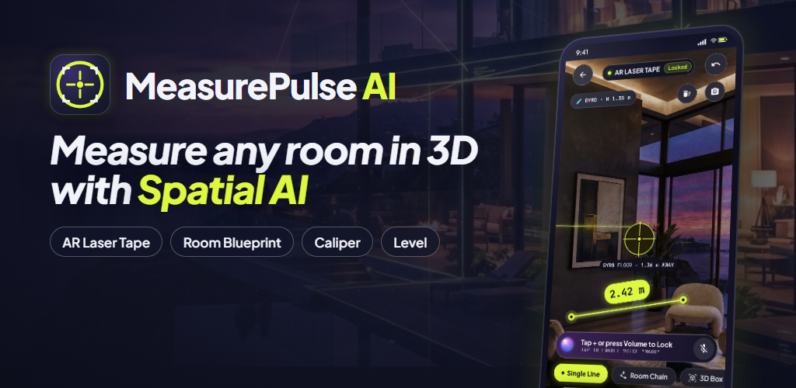

# MeasurePulse AI — 3D AR Laser Tape, Room Blueprint, Caliper & Level

Native Android app (Kotlin · Jetpack Compose · ARCore optional · CameraX · ML Kit · Glance widgets · AdMob + UMP · Play Billing 8).

**Website:** https://sunilkumar101.github.io/measurepulse-ai-ar-tape/ · **Privacy policy:** https://sunilkumar101.github.io/measurepulse-ai-ar-tape/privacy-policy.html



## What's inside

| Path | Contents |
|---|---|
| `app/` | The Android app (package `com.measurepulse.ar`, compile/target SDK 36, min SDK 26, 16 KB page-size ready) |
| `docs/` | GitHub Pages site: SEO landing page, privacy policy, terms, sitemap, robots.txt, app-ads.txt |
| `fastlane/` | Play Store listing metadata (title, descriptions, changelog, screenshots, icon, feature graphic) and upload lanes |
| `playstore_assets/` | Rendered store screenshots, feature graphic, 512 px icon and the two 18 s promo videos |
| `promo-video/` | Remotion project that renders the promo videos and store images |
| `design_screenshots/` | Original screen designs |

## Build

```bash
# JDK 17–21 (Android Studio's bundled JBR works)
./gradlew testDebugUnitTest assembleDebug
./gradlew bundleRelease   # needs keystore.properties (git-ignored) for the upload key
```

Release AdMob IDs are read from `measurepulse.admob.*` in `local.properties` / `gradle.properties`; debug builds always use Google's test ads.

## Privacy

Camera frames, ARCore depth data and the "Mark" voice keyword are processed only on the device and are never recorded or uploaded. See the [privacy policy](https://sunilkumar101.github.io/measurepulse-ai-ar-tape/privacy-policy.html).
